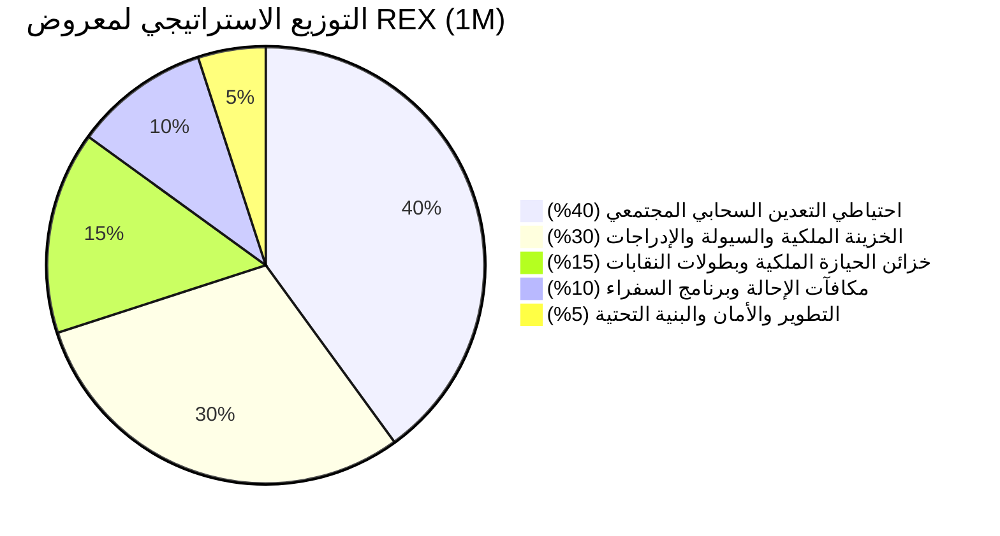
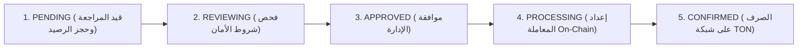

# 👑 الورقة البيضاء الرسمية لمنظومة ROYAL ELITE X (REX) — إصدار 2026
## الدليل الشامل للبنية التحتية، التوكنوميكس، بروتوكول تعدين الحيازة، ومحرك السحب المؤسسي
### المبني أصلياً على شبكة بلوكتشين TON (The Open Network) وتيليجرام

---

> [!IMPORTANT]
> **وثيقة معتمدة ورسمية لمنظومة ROYAL ELITE X**  
> تلخص هذه الورقة البيضاء كافة التفاصيل التقنية، المالية، الاقتصادية، والأمنية لبوت وتطبيق **ROYAL ELITE X (REX)**، ومحرك السحب المؤسسي، وضوابط السيولة على منصة STON.fi اللامركزية.

---

## 1. الملخص التنفيذي والرؤية الاستراتيجية (Executive Summary)

**ROYAL ELITE X (REX)** هي منظومة تعدين سحابي واقتصاد ويب 3 (Web3) متكاملة مبنية أصلياً على بلوكتشين **TON (The Open Network)** ومدمجة مباشرة داخل منصة **Telegram**. صُممت المنظومة بطابع ملكي سيادي يجمع بين التفاعل الاجتماعي والتمويل اللامركزي (DeFi)، والتداول المباشر عبر مجمعات السيولة الآلية (AMM) على منصة **STON.fi DEX**، مع سجل تدقيق مالي مزدوج (Double-Entry Financial Ledger).

### المشكلات القاتلة في مشاريع التاب السابقة وكيف تحلها REX:
1. **التضخم المفرط (Hyperinflation):** معظم البوتات تطبع مليارات العملات الوهمية دون سقف، بينما تمتلك REX **معروضاً ثابتاً ومغلقاً نهائياً قدره 1,000,000 عملة فقط** يستحيل زيادته.
2. **جيوش البوتات والمزارع الوهمية (Sybil Farms):** تم القضاء عليها نهائياً عبر **بوابة التحقق السيادية برسم رمزي (0.1 TON)** مع ربط محفظة خارجية غير احتجازية وبصمة جهاز فريدة.
3. **انهيار الأسعار الفوري عند السحب (Liquidity Draining & Instant Dump):** تم حلها عبر **شرط حيازة 5,000 REX في المحفظة لمدة 3 أيام متتالية (72 ساعة)** لفتح السحب، ونظام **مراقبة ما بعد السحب لمدة 24 ساعة (Anti-Dump Guard)**.
4. **انعدام فائدة الاحتفاظ بالعملة:** في REX، كلما احتفظت بعملات أكثر في محفظتك On-Chain، تضاعفت سرعة تعدينك حتى **25 ضعفاً (25x)**، مما يخلق ضغط شراء مستمر على منصة التداول STON.fi.

---

## 2. المواصفات التقنية والعقد الذكي على بلوكتشين TON

| البند التقني | التفاصيل الرسمية والمعتمدة |
| :--- | :--- |
| **اسم العملة** | ROYAL ELITE X |
| **رمز التداول (Ticker)** | **REX** |
| **شبكة البلوكتشين** | TON Mainnet (شبكة TON الرئيسية) |
| **معيار الرمز (Standard)** | TEP-74 Jetton Fungible Standard |
| **إجمالي المعروض الثابت (Total Supply)** | **1,000,000 REX** (مغلق نهائياً وغير قابل للسك أو التضخم) |
| **العقد الذكي الرئيسي (Jetton Master)** | `EQBjOwteVkpjofTFQRFRLqRSb7SSYDxtJSXh8DnIFV7_oaLX` |
| **زوج التداول الرسمي اللامركزي** | **REX / GRAM** على منصة **STON.fi DEX v2** |
| **عنوان مجمع السيولة (STON.fi Pool)** | `EQAkNyk6B1PgiEcBWkXG5d7C137Epx_iAQnB6ZCIVU7E4INR` |
| **الشارت والأسعار اللحظية** | [شارت مباشر على DexScreener](https://dexscreener.com/ton/eqaknyk6b1pgiecbwkxg5d7c137epx_iaqnb6zcivu7e4inr) |
| **مستكشف المعاملات الرسمي** | [Tonviewer REX Jetton Explorer](https://tonviewer.com/EQBjOwteVkpjofTFQRFRLqRSb7SSYDxtJSXh8DnIFV7_oaLX) |
| **البوت الرسمي على تيليجرام** | [@Royalelitexbot](https://t.me/Royalelitexbot) |
| **القناة الإلزامية للمجتمع** | [@REXCEO1A](https://t.me/REXCEO1A) |

---

## 3. التوكنوميكس والتوزيع المالي العادل (Strategic Tokenomics)

تم تقسيم إجمالي المعروض الثابت البالغ **1,000,000 REX** وفق دراسة اقتصادية دقيقة تضمن استدامة المنظومة لسنوات:

### تفاصيل الحصص:
1. **40% (400,000 REX) — احتياطي التعدين السحابي المجتمعي:**
   * يتم توزيعه تدريجياً عبر دورات التعدين اليومية (Proof-of-Engagement).
   * **سقف الانبعاث اليومي الأقصى:** 50,000 REX لجميع المستخدمين حول العالم لمنع الإغراق.
2. **30% (300,000 REX) — الخزينة الملكية، توفير السيولة، وإدراجات المنصات (CEX):**
   * مخصصة لتزويد مجمعات السيولة على STON.fi وتمويل الإدراج في المنصات المركزية العالمية.
3. **15% (150,000 REX) — خزائن الحيازة (Vaults) وبطولات النقابات:**
   * مكافآت للمستخدمين الذين يقفلون أرصدتهم طوعياً ومكافآت بطولات النقابات الأسبوعية.
4. **10% (100,000 REX) — مكافآت الإحالة وبرنامج الفرسان السفراء:**
   * تمويل برنامج الشراكة وعمولات الإحالة مدى الحياة (5%) وعروض الإحالة المزدوجة.
5. **5% (50,000 REX) — التطوير المستمر، التدقيق الأمني، والخوادم السحابية:**
   * حماية البنية التحتية وصيانة السيرفرات والترقيات البرمجية.

---

## 4. بوابة الأمان الملكية ومكافحة الحسابات الوهمية (Anti-Sybil Defense)

لضمان أن 100% من المشاركين هم مستخدمون حقيقيون وحماية القيمة المالية للعملة:
1. **ربط محفظة TON اللامركزية:** لا يمكن لأي مستخدم بدء النشاط دون ربط محفظة خارجية حقيقية (Tonkeeper، MyTonWallet، Telegram Wallet).
2. **رسم التحقق السيادي الرمزي (0.1 TON):**
   * يدفع المستخدم 0.1 TON لمرة واحدة على البلوكتشين لتفعيل حسابه.
   * هذا الحاجز يمنع إنشاء آلاف الحسابات الوهمية من قبل السكربتات الخبيثة، لأن تكلفة تشغيل 10,000 بوت ستتطلب 1,000 TON حقيقي، مما يجعل الاحتيال مستحيلاً اقتصادياً.
3. **رادار بصمة الأجهزة والشبكات (Device Fingerprinting & IP Clustering):**
   * تتبع البصمات البرمجية ومصادقة `Telegram initData` المشفرة عبر `HMAC-SHA256`.
4. **الاشتراك الإلزامي بالقناة الرسمية (@REXCEO1A):**
   * التحقق الآلي من عضوية المستخدم بالقناة قبل السماح بالدخول.

---

## 5. بروتوكول تعدين الحيازة ومضاعفات الرتب الملكية (The 6 Holding Tiers)

في ROYAL ELITE X، العملة ليست مجرد أرقام تُجمع، بل هي أصل استثماري يمنحك **قوة تعدين مضاعفة** كلما احتفظت بها في محفظتك الشخصية:

### جدول الرتب ومضاعفات التعدين:

| مستوى الرتبة | اسم الرتبة السيادية | شرط الحيازة في المحفظة (On-Chain) | مضاعف السرعة | الإنتاج اليومي (24 ساعة) | الإنتاج في الساعة | الميزة الاستراتيجية الرئيسية |
| :---: | :--- | :---: | :---: | :---: | :---: | :--- |
| **Tier 1** | 🥉 **المستكشف البرونزي (Bronze Explorer)** | $0 - 499\text{ REX}$ | **1.0x** | $100\text{ REX}$ | $4.16\text{ REX}$ | البداية الأساسية دون شروط حيازة |
| **Tier 2** | 🥈 **الحارس الفضي (Silver Guardian)** | $500 - 1,999\text{ REX}$ | **2.0x** | $200\text{ REX}$ | $8.33\text{ REX}$ | مضاعفة الإنتاج اليومي 100% |
| **Tier 3** | 🥇 **الفارس الذهبي (Gold Knight)** | $2,000 - 4,999\text{ REX}$ | **4.0x** | $400\text{ REX}$ | $16.66\text{ REX}$ | أربعة أضعاف سرعة التعدين الأساسية |
| **Tier 4** | 💠 **البارون البلاتيني (Platinum Baron)** | $5,000 - 14,999\text{ REX}$ | **7.0x** | $700\text{ REX}$ | $29.16\text{ REX}$ | **فتح أهلية السحب وبدء عداد الـ 3 أيام** |
| **Tier 5** | 💎 **الدوق الماسي VIP (Diamond Duke)** | $15,000 - 49,999\text{ REX}$ | **15.0x** | $1,500\text{ REX}$ | $62.50\text{ REX}$ | رتبة كبار المستثمرين VIP |
| **Tier 6** | 👑 **الإمبراطور الملكي (Crown Sovereign)** | $50,000+\text{ REX}$ | **25.0x** | $2,500\text{ REX}$ | $104.16\text{ REX}$ | **أقصى مضاعف تعدين في المنظومة (25x)** |

---

## 6. شرط فك قفل السحب الإلزامي (The 5,000 REX 3-Day Rule)

لضمان استقرار سعر العملة ومنع استنزاف السيولة، وُضعت شروط أمان حازمة للسحب:

1. **الحد الأدنى لحيازة المحفظة:**
   * يجب أن يمتلك المستخدم في محفظته الخارجية المتصلة ما لا يقل عن **5,000 REX** (شراؤها من منصة STON.fi DEX أو الاحتفاظ بها).
2. **فترة الحيازة الإلزامية (3 أيام متتالية / 72 ساعة):**
   * يجب بقاء الـ 5,000 REX داخل المحفظة لمدة 72 ساعة متواصلة دون بيع أو تحويل.
   * يظهر عداد تنازلي حي وشريط تقدم (0% إلى 100%) داخل قسم السحب بالتطبيق.
3. **التصفير الفوري عند البيع (Instant Reset):**
   * إذا قام المستخدم ببيع أي جزء من رصيده وانخفض الرصيد عن 5,000 REX، **يتم تصفير العداد فوراً وإلغاء التقدم**، ويجب عليه البدء من جديد لمدة 3 أيام كاملة.
4. **شرط الـ 20% On-Chain:**
   * يجب أن تعادل حيازة المستخدم في محفظته الخارجية 20% على الأقل من المبلغ المراد سحبه.

---

## 7. محرك السحب المؤسسي خماسي المراحل ورسوم السحب (Withdrawals & 500 REX Fee)

### أ. رسوم السحب (500 REX Fee):
* يُفرض رسم معالجة وشبكة قدره **500 REX** على كل عملية سحب.
* **طريقة التطبيق:**
  * يطلب المستخدم سحب المبلغ (مثلاً: الحد الأدنى `5,000 REX`).
  * يُحجز كامل المبلغ من رصيده في سجل المعاملات المزدوج.
  * تُستقطع رسوم المنظومة: **`500 REX`**.
  * **صافي المبلغ الذي يصل للمحفظة على البلوكتشين:** **`4,500 REX`** (`المبلغ المطلوب - 500`).
* إذا تم رفض أو إلغاء الطلب لأي سبب، يُسترجع كامل المبلغ إلى رصيد المستخدم فوراً.

### ب. دورة حياة طلب السحب خماسية المراحل:

### ج. ضمان التسليم خلال 24 ساعة:
* فور الموافقة على الطلب، يتم التحويل المباشر لمحفظة المستخدم عبر محفظة البوت المعتمدة (`v4R2`).
* يحصل المستخدم على إشعار تيليجرام فوري يتضمن رابط المعاملة المباشر على **Tonviewer**.

---

## 8. سياسة مكافحة الإغراق بعد السحب (24h Anti-Dump Guard)

* **حظر بيع لمدة 24 ساعة:** بعد استلام السحب بنجاح على المحفظة الخارجية، يمنع بيع أو تحويل العملات المستلمة لمدة 24 ساعة كاملة.
* **رادار المراقبة الآلي:** يقوم السيرفر بفحص رصيد المحفظة On-Chain، وإذا تم رصد عملية بيع أو تصريف، يتم **حظر الحساب نهائياً وتجميد أي وصول مستقبلي**، لحماية حاملي العملة والمستثمرين على STON.fi.

---

## 9. أقسام وميزات المنظومة الملكية (Ecosystem Modules)

### ⛏️ 1. التعدين السحابي (Royal Mining)
* دورة تعدين ذكية تمتد 24 ساعة وتعمل بنظام الإثبات التفاعلي (Proof-of-Engagement)، حيث يتطلب الأمر نقرة تفعيل يومية لمنع الحسابات المهجورة من مراكمة المكافآت.

### 📋 2. المهام الملكية المتجددة (Repeatable Quests)
* خمس مهام متكررة تمنح عملات REX ونقاط XP:
  * تسجيل الدخول اليومي المتتابع (+50 REX / 24h) مع حماية ضد التكرار.
  * الصندوق الملكي الغامض (+20 إلى 60 REX / 4h).
  * شاحن الطاقة السحابي (+35 REX / 6h).
  * المشاركة الاجتماعية الملكية (+75 REX / 12h).
  * التفاعل المجتمعي الملكي (+30 REX / 8h).

### 🏛️ 3. الخزينة الملكية وقفل الحيازة (Royal Staking Vaults)
* خزائن قفل طوعي لمدد (30، 90، 180، 365 يوماً) تمنح مضاعفات إضافية من 1.25x إلى 3.0x دون فقدان ملكية العملة.

### 🛡️ 4. النقابات الملكية والتحالفات (Royal Guilds)
* تحالفات جماعية ينشئها القادة لجمع قوى التعدين، التنافس في بطولات أسبوعية، والحصول على حصة من مجمع المكافآت الملكي.

### 🎓 5. أكاديمية REX لعلوم البلوكتشين (REX Web3 Academy)
* مساقات تعليمية تفاعلية حول شبكة TON، معايير Jetton، أمان الكلمات المفتاحية، ومفاهيم DeFi مع اختبارات قصيرة ومكافآت فورية.

### 🎟️ 6. محرك استرداد الأكواد الترويجية (Promo Code Engine)
* محرك ذري مدمج يتيح للأدمن إنشاء أكواد هدايا محددة بعدد استخدامات وتاريخ صلاحية ومكافآت فورية، مع نظام حماية يمنع استخدام الكود أكثر من مرة للحساب الواحد.

### 👥 7. برنامج الفرسان السفراء وعرض الإحالة المزدوجة (Referral Bounty)
* نظام إحالة من مستويين:
  * **مكافأة فورية:** 50 REX للمحيل فور تفعيل الصديق.
  * **عرض الإحالة المزدوجة:** 1,000 REX للمحيل و 500 REX للصديق الجديد.
  * **عمولة سيادية مدى الحياة:** 5% من كل أرباح تعدين الصديق تضاف تلقائياً لحساب المحيل.

---

## 10. الأمان المعماري وسجل المعاملات المزدوج (Architecture & Ledger)

* **المصادقة المشفرة (Cryptographic Authentication):** التحقق من هوية المستخدمين وبيانات Telegram WebApp عبر توقيع `HMAC-SHA256` باستخدام مفتاح البوت السري.
* **سجل التدقيق المالي المزدوج (Double-Entry Financial Ledger):** كل حركة مالية (تعدين، مهمة، إحالة، حجز، سحب، استرداد كود) تُسجل كحركة ائتمان/خصم مع مفتاح فريد لمنع تكرار العمليات (Idempotency).
* **قاعدة بيانات SQLite بوضع WAL المتطور:** معالجة آلاف العمليات المتزامنة في الثانية مع دعم أكثر من 100,000 مستخدم نشط يومياً.
* **الصفرية الاحتجازية (Zero-Custody):** لا يطلب البوت ولا يخزن مفاتيح المستخدمين الخاصة نهائياً.

---

## 11. الروابط الرسمية وقنوات التحقق

* **البوت الرسمي:** [@Royalelitexbot](https://t.me/Royalelitexbot)
* **قناة الإعلانات الرسمية:** [@REXCEO1A](https://t.me/REXCEO1A)
* **رابط التداول والشراء على STON.fi:** [Trade REX on STON.fi DEX](https://app.ston.fi/swap?chartVisible=true&ft=EQAAAAAAAAAAAAAAAAAAAAAAAAAAAAAAAAAAAAAAAAAAAM9c&tt=EQBjOwteVkpjofTFQRFRLqRSb7SSYDxtJSXh8DnIFV7_oaLX)
* **رابط الشارت على DexScreener:** [REX / GRAM Live Chart](https://dexscreener.com/ton/eqaknyk6b1pgiecbwkxg5d7c137epx_iaqnb6zcivu7e4inr)
* **مستكشف العقد الذكي على Tonviewer:** [EQBjOwteVkpjofTFQRFRLqRSb7SSYDxtJSXh8DnIFV7_oaLX](https://tonviewer.com/EQBjOwteVkpjofTFQRFRLqRSb7SSYDxtJSXh8DnIFV7_oaLX)

---

*حقوق النشر © 2026 مؤسسة ROYAL ELITE X (REX). جميع الحقوق محفوظة.*  
*البنية التحتية اللامركزية والسيادية على بلوكتشين TON.*
